# ☕ PLAN B // DOSSIER INTEGRAL DO PROJETO & PLANO DE NEGÓCIO EXECUTIVO
> **Master Document do Cybercafé & Hacker Lounge:** Conceito & Manifesto, Arquitetura de Espaços, Especificações Técnicas de Workstations, Identidade Visual & Branding, Carta & Menus Gastronómicos, Linha de Merchandising, Estudo Imobiliário & Localizações, Orçamento Detalhado (CapEx & OpEx), Modelo Financeiro, Academia & Bastidores, Telecomunicações e Desafio Criptográfico (CTF).

---

## 📑 Índice Temático
1. [Tema 1: Conceito, Filosofia & Pilares Fundamentais](#tema-1-conceito-filosofia--pilares-fundamentais)
2. [Tema 2: Arquitetura & Distribuição de Espaços (Piso Principal & Bastidores)](#tema-2-arquitetura--distribuição-de-espaços-piso-principal--bastidores)
3. [Tema 3: Estações de Trabalho, Hacker Rigs & Infraestrutura Maker](#tema-3-estações-de-trabalho-hacker-rigs--infraestrutura-maker)
4. [Tema 4: Identidade de Marca, Branding & Arte ASCII](#tema-4-identidade-de-marca-branding--arte-ascii)
5. [Tema 5: Gastronomia de Autor & Carta de Cafetaria de Especialidade](#tema-5-gastronomia-de-autor--carta-de-cafetaria-de-especialidade)
6. [Tema 6: Linha Oficial de Merchandising ("Hardware & Apparel")](#tema-6-linha-oficial-de-merchandising-hardware--apparel)
7. [Tema 7: Estudo Imobiliário & Levantamento de Localizações Reais](#tema-7-estudo-imobiliário--levantamento-de-localizações-reais)
8. [Tema 8: Orçamento Integral de Investimento (CapEx)](#tema-8-orçamento-integral-de-investimento-capex)
9. [Tema 9: Custos Operacionais (OpEx) & Modelo Financeiro de Break-Even](#tema-9-custos-operacionais-opex--modelo-financeiro-de-break-even)
10. [Tema 10: Academia Hacker, Formações Especializadas & Especificações do Bunker](#tema-10-academia-hacker-formações-especializadas--especificações-do-bunker)
11. [Tema 11: Infraestrutura de Telecomunicações, Cibersegurança & Regras de Convivência](#tema-11-infraestrutura-de-telecomunicações-cibersegurança--regras-de-convivência)
12. [Tema 12: Terminal CLI Interativo, Comandos & Telemetria em Tempo Real](#tema-12-terminal-cli-interativo-comandos--telemetria-em-tempo-real)
13. [Tema 13: Desafio Criptográfico (CTF Captive Portal & Credencial Hacker)](#tema-13-desafio-criptográfico-ctf-captive-portal--credencial-hacker)
14. [Tema 14: Catálogo Visual & Galeria Fotográfica do Espaço](#tema-14-catálogo-visual--galeria-fotográfica-do-espaço)

---

## Tema 1: Conceito, Filosofia & Pilares Fundamentais

O **Plan B** é um cybercafé de terceira geração concebido para fundir a atmosfera acolhedora e analógica dos cibercafés dos anos 90/2000 com o rigor contemporâneo do café de especialidade, o foco produtivo da cultura hacker/open-source e a pastelaria tradicional portuguesa.

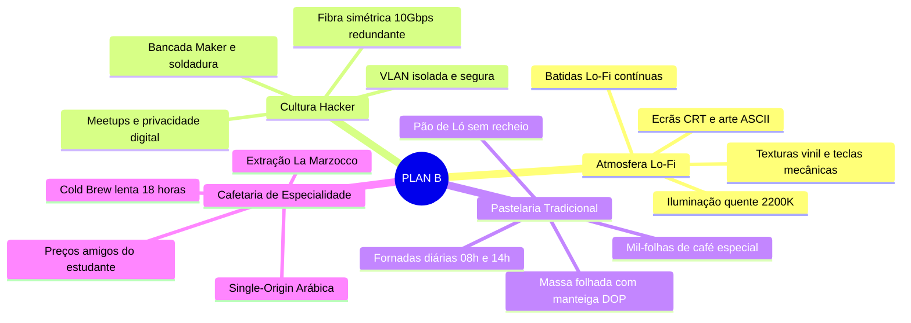

### Pilares Estruturais

| Pilar | Descrição Operacional | Implementação no Espaço |
| :--- | :--- | :--- |
| **Atmosfera Lo-Fi & Terminal** | Redução do ruído visual e sonoro para estado de fluxo mental (*deep work*). | Lâmpadas de filamento âmbar 2200K, paleta obsidiana/café torrado, acústica controlada (45–50 dB) com música lo-fi vinilada. |
| **Cultura Hacker & Geek** | Espaço aberto para entusiastas de hardware, programadores e especialistas de segurança. | 12 estações com monitores 4K, teclados mecânicos Keychron Q, portas USB-C PD 100W e bancada com Pinecil/Raspberry Pi. |
| **Pastelaria Pura de Autor** | Preservação da pureza gastronómica portuguesa aliada à doçaria de conforto. | Pão de Ló estritamente tradicional (sem recheio, gema cozida por inteiro) e Mil-Folhas de café de infusão a frio. |
| **Acessibilidade Académica** | Preços justos calibrados para polos universitários (UBI Covilhã, Porto, Lisboa). | Espresso de especialidade a € 0.80, menus combinados a € 2.60–€ 3.20. |

---

## Tema 2: Arquitetura & Distribuição de Espaços (Piso Principal & Bastidores)

O espaço físico divide-se em duas grandes zonas complementares: o **Piso Principal Aberto** (cafetaria, lounge e estações públicas) e a **Zona Técnica / Bastidores** (bunker maker, sala de segurança e homelab).

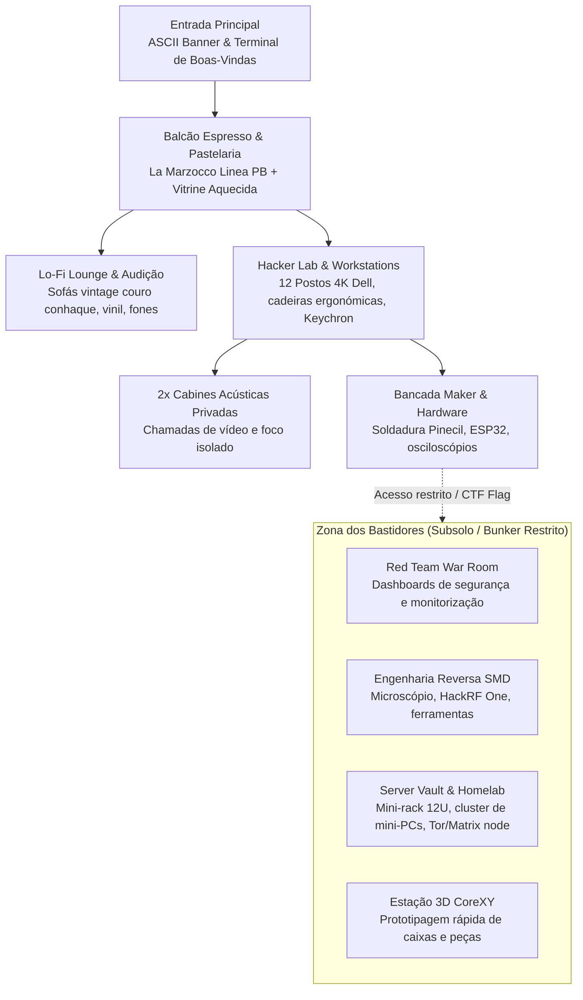

### Zoneamento e Áreas Úteis (150 m²)

| Zona | Área Útil | Lotação | Equipamento & Acabamentos |
| :--- | :---: | :---: | :--- |
| **Balcão & Pastelaria** | 40 m² | 4 staff | Balcão em nogueira e latão, forno convector vapor Unox, máquina La Marzocco Linea PB. |
| **Lo-Fi Lounge** | 45 m² | 16 lugares | Sofás Chesterfield couro conhaque, gira-discos Pro-Ject, fones Sennheiser abertos. |
| **Hacker Workstations** | 45 m² | 12 lugares | Bancadas longas de nogueira maciça, 8x monitores 4K Dell 32", 12x cadeiras ergonómicas. |
| **Cabines Acústicas** | 6 m² | 2 pessoas | Vidro duplo laminado acústico, ventilação ativa silenciosa, iluminação de vídeo. |
| **Bancada Maker** | 4 m² | 2 postos | Exaustor de fumos HEPA, estações digitais Pinecil, kits Raspberry Pi 5 e ESP32. |
| **Armazém & Sanitários** | 10 m² | Circulação | 2 WC (1 adaptado a mobilidade reduzida), calhas técnicas e armazenamento de insumos. |

---

## Tema 3: Estações de Trabalho, Hacker Rigs & Infraestrutura Maker

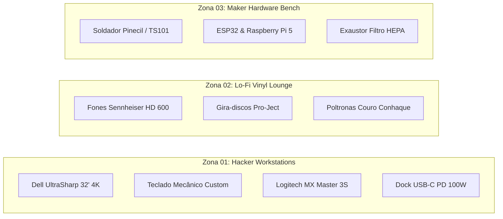

### Especificações das 3 Zonas de Trabalho no Piso Principal

| Zona | Designação | Especificação Técnica | Política de Acesso e Preço |
| :--- | :--- | :--- | :--- |
| **ZONA 01** | **Estações Hacker "Root Access"** | Monitores Dell UltraSharp 4K 32" Antirreflexo em braço a gás; Teclados mecânicos custom com switches Boba U4T/Gateron Oil Kings; Ratos Logitech MX Master 3S; Dock Thunderbolt 4 / USB-C 100W PD; Ethernet Gigabit RJ-45 com VLAN isolada; Cadeiras ergonómicas certificadas Herman Miller / Sihoo Doro S300. | **€ 1.50/h** (ou **Gratuito** com qualquer consumo na cafetaria). |
| **ZONA 02** | **Lo-Fi Vinyl & Reading Lounge** | Poltronas vintage em pele conhaque e mesas baixas de nogueira maciça; Auscultadores abertos de estúdio Sennheiser HD 600 em cada posto; Gira-discos Pro-Ject Debut Carbon; Biblioteca de zines de computação, manuais UNIX retro e ficção cyberpunk; Iluminação âmbar 2200K de intensidade regulável; Tomadas Schuko e portas GaN embutidas. | **Acesso Livre** a todos os clientes do cybercafé. |
| **ZONA 03** | **Maker & Hardware Bench** | Estações de soldar digitais Pinecil / TS101 e multímetros de bancada; Kits de prototipagem rápida ESP32, Raspberry Pi 5, Flipper Zero labs e breadboards; Extratores de fumo individuais com filtro de carvão ativado; Bancada com ferramentas de precisão iFixit e osciloscópios. | **€ 2.00/h** (materiais básicos de soldadura incluídos). |

---

## Tema 4: Identidade de Marca, Branding & Arte ASCII

### Paleta Cromática Oficial

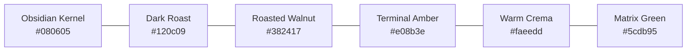

| Token de Cor | Hex Code | Referência Pantone | Função no Sistema Visual |
| :--- | :--- | :--- | :--- |
| **Obsidian Kernel** | `#080605` | Pantone Black 6 C | Fundo primordial, profundidade de ecrã OLED e imersão total. |
| **Dark Roast Espresso** | `#120c09` | Pantone 440 C | Superfícies secundárias, cartões, fundos de secções e estofos. |
| **Roasted Walnut** | `#382417` | Pantone 469 C | Madeira de nogueira maciça, molduras, divisórias e bordas. |
| **Terminal Amber** | `#e08b3e` | Pantone 151 C | Destaques de ação, títulos principais, botões e fósforo CRT. |
| **Warm Crema** | `#faeedd` | Pantone 7527 C | Tipografia principal, espuma de café, conforto de leitura prolongada. |
| **Muted Coffee Ash** | `#967d6a` | Pantone 7531 C | Textos secundários, comentários de código e metadados. |
| **Matrix Green Accent**| `#5cdb95` | Pantone 7488 C | Acentos funcionais de status "OK", portas abertas e sucesso de rede. |

### Tipografia Oficial
* **Código, UI & Terminal:** `JetBrains Mono` / `Fira Code` (Monospace profissional com ligaduras).
* **Display / Títulos CRT:** `VT323` (Nostalgia 8-bit / fósforo âmbar anos 80).
* **Editorial & Kraft Físico:** `Space Mono` ou `Courier Prime`.

### Arte ASCII de Marca

```
 ____  _        _    _   _   ____     __  __
|  _ \| |      / \  | \ | | | __ )   / / / /
| |_) | |     / _ \ |  \| | |  _ \  / / / / 
|  __/| |___ / ___ \| |\  | | |_) |/ / / /  
|_|   |_____/_/   \_\_| \_| |____//_/ /_/   
  ____ __   ______  _____ ____   ____    _    _____ _____ 
 / ___|\ \ / / __ )| ____|  _ \ / ___|  / \  |  ___| ____|
| |     \ V /|  _ \|  _| | |_) | |     / _ \ | |_  |  _|  
| |___   | | | |_) | |___|  _ <| |___ / ___ \|  _| | |___ 
 \____|  |_| |____/|_____|_| \_\____/_/    \_\_|   |_____|
```

---

## Tema 5: Gastronomia de Autor & Carta de Cafetaria de Especialidade

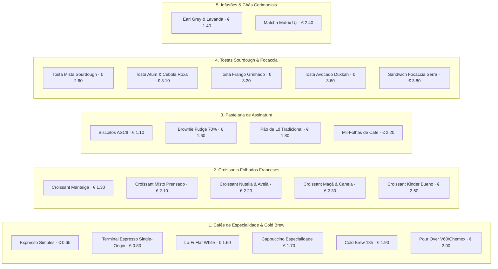

### Menu Completo dos 22 Itens Estruturado por Categorias

#### ☕ Cafés & Cold Brew (Extrações Quentes e a Frio)
| ID | Item | Preço | Especificação Técnica / Método | Imagem no Catálogo |
| :---: | :--- | :---: | :--- | :--- |
| **c1** | **Café Expresso Simples** | **€ 0.65** | Extração tradicional 7g / 9 bar / 25s, crema aveludada | `assets/menu_expresso_simples.jpg` |
| **c2** | **Terminal Espresso (Single Origin)** | **€ 0.80** | Lote arábica selecionado moído na hora (18g in - 36g out) | `assets/menu_espresso.jpg` |
| **c3** | **Lo-Fi Flat White (127.0.0.1)** | **€ 1.60** | Ristretto duplo com microespuma vaporizada a 62°C | `assets/menu_flatwhite.jpg` |
| **c4** | **Cappuccino de Especialidade** | **€ 1.70** | Espresso duplo, leite vaporizado aveludado e cacau 80% | `assets/menu_cappuccino.jpg` |
| **c5** | **Cold Brew [DAEMON] 18h** | **€ 1.90** | Maceração a frio 18 horas em água filtrada | `assets/menu_coldbrew.jpg` |
| **c6** | **Chemex / V60 Pour Over** | **€ 2.00** | Rácio 1:16, água a 93°C, moagem uniforme EK43S | `assets/menu_pourover.jpg` |

#### 🥐 Croissants Folhados Artesanais (Doces & Salgados)
| ID | Item | Preço | Especificação Técnica / Método | Imagem no Catálogo |
| :---: | :--- | :---: | :--- | :--- |
| **cr1**| **Croissant Artesanal de Manteiga** | **€ 1.30** | Massa folhada laminada com 27 camadas de manteiga pura | `assets/menu_croissant.jpg` |
| **cr2**| **Croissant Misto Prensado** | **€ 2.10** | Prensado a quente (200°C), queijo derretido e fiambre | `assets/menu_croissant_misto.jpg` |
| **cr3**| **Croissant Recheado com Nutella** | **€ 2.20** | Recheio farto de Nutella, fios de cacau e avelãs tostadas | `assets/menu_croissant_nutella.jpg` |
| **cr4**| **Croissant de Doce de Maçã & Canela** | **€ 2.30** | Compota artesanal com pedaços caramelizados e canela | `assets/menu_croissant_maca.jpg` |
| **cr5**| **Croissant Especial Kinder Bueno** | **€ 2.50** | Ganache marmoreada, pedaços Kinder Bueno e creme de avelã | `assets/menu_croissant_kinder.jpg` |

#### 🍰 Pastelaria Tradicional & De Autor
| ID | Item | Preço | Especificação Técnica / Método | Imagem no Catálogo |
| :---: | :--- | :---: | :--- | :--- |
| **p1** | **Biscoitos ASCII Cardamomo** | **€ 1.10** | Manteiga, cardamomo moído, carimbo ASCII em relevo | `assets/menu_biscoitos.jpg` |
| **p2** | **Brownie Fudge Café & Nozes** | **€ 1.60** | Chocolate 70% belga, nozes tostadas e dose de ristretto | `assets/menu_brownie.jpg` |
| **p3** | **Pão de Ló Tradicional (Sem Recheio)** | **€ 1.80** | Cozido a 180°C, massa pura, ovos inteiros e farinha | `assets/especialidade_paodelo.jpg` |
| **p4** | **Mil-Folhas de Café Especial** | **€ 2.20** | Massa folhada laminada, infusão cold-steep 24h | `assets/especialidade_milfolhas.jpg` |

#### 🥪 Tostas Sourdough & Sandwiches (Pão de Fermentação Lenta)
| ID | Item | Preço | Especificação Técnica / Método | Imagem no Catálogo |
| :---: | :--- | :---: | :--- | :--- |
| **b1** | **Tosta Mista em Pão Sourdough** | **€ 2.60** | Pão fermentação lenta, queijo derretido e fiambre perna | `assets/menu_tosta_mista.jpg` |
| **b2** | **Tosta de Atum & Cebola Roxa** | **€ 3.10** | Pasta cremosa de atum, cebola roxa, salsa e queijo | `assets/menu_tosta_atum.jpg` |
| **b3** | **Tosta de Frango Grelhado & Ervas** | **€ 3.20** | Frango desfiado marinado, queijo, rúcula e azeite | `assets/menu_tosta_frango.jpg` |
| **b4** | **Tosta Hacker Sourdough & Avocado** | **€ 3.60** | Fermentação lenta 48h, dukkah artesanal, azeite | `assets/menu_tosta.jpg` |
| **b5** | **Sandwich Focaccia & Queijo da Serra** | **€ 3.80** | Focaccia de alecrim grelhada com Queijo da Serra DOP | `assets/menu_focaccia.jpg` |

#### 🍵 Chás & Matcha Cerimonial
| ID | Item | Preço | Especificação Técnica / Método | Imagem no Catálogo |
| :---: | :--- | :---: | :--- | :--- |
| **t1** | **Earl Grey & Lavanda [ROOT]** | **€ 1.40** | Bergamota natural da Calábria, infusão 4 min | `assets/menu_earlgrey.jpg` |
| **t2** | **Matcha Matrix Cerimonial** | **€ 2.40** | Grau cerimonial de Uji, batido com chasen tradicional | `assets/menu_matcha.jpg` |

---

## Tema 6: Linha Oficial de Merchandising ("Hardware & Apparel")

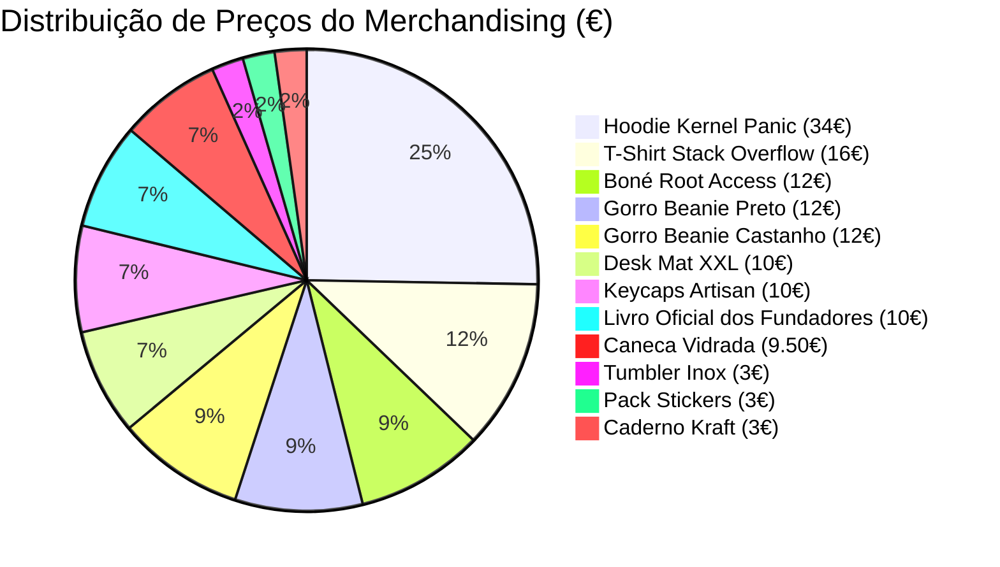

### Catálogo de Artigos Oficiais

| Artigo | Material & Fabrico | Detalhe Estético | PVP |
| :--- | :--- | :--- | :---: |
| **Hoodie "Kernel Panic"** | 100% Algodão francês 450 gsm orgânico escuro | Bordado tonal na frente; costas com `curl https://planb.cafe/coffee.sh` e receita em pseudocódigo. | **€ 34.00** |
| **T-Shirt "Stack Overflow"** | Algodão cru pré-lavado 240 gsm | Tipografia âmbar com código `HTTP 418: I'm a teapot (and I need coffee)`. | **€ 16.00** |
| **Boné "Root Access"** | Sarja de algodão escuro com fivela de latão | Patch bordado `[PLAN_B]` em relevo discreto. | **€ 12.00** |
| **Gorro Beanie // Preto Obsidiana** | Malha grossa canelada em 100% lã merino preta | Patch frontal bordado com `[PLAN_B]` em fio âmbar suave. | **€ 12.00** |
| **Gorro Beanie // Castanho Café** | Malha canelada premium castanho torrado espresso | Etiqueta tecida minimalista com pormenores âmbar e nogueira. | **€ 12.00** |
| **Desk Mat XXL "Terminal Grid"** | Microfibra rápida (900x400x4mm) + borracha natural | Blueprint PCB com atalhos de terminal e Vim gravados no canto. | **€ 10.00** |
| **Keycaps Artisan (Pack 2)** | Resina PBT bicolor castanho café e âmbar translúcido | Tecla `ESC` com relevo Pão de Ló; tecla `ENTER` com `[EXEC_BREW]`. | **€ 10.00** |
| **Livro // "Plano B: Guia Foco"** | Impressão em papel reciclado kraft encadernado | Manual prático de carreira tech, foco profundo e relato dos fundadores ex-SOC. | **€ 10.00** |
| **Caneca Cerâmica Vidrada** | Cerâmica feita ao torno em Barcelos/Caldas (350ml) | Preto mate exterior e caramelo interior com selo carimbado ASCII. | **€ 9.50** |
| **Tumbler Térmico Inox 500ml** | Aço 304 vácuo duplo com interior cerâmico | Preto mate com gravação laser; mantém quente 6h / frio 18h. | **€ 3.00** |
| **Pack Stickers Vinil (x6)** | Vinil mate impermeável à prova de UV | `sudo eat-paodelo`, `milfolhas.overflow()`, `caffeine > sleep`. | **€ 3.00** |
| **Caderno Kraft de Engenharia** | Papel pontilhado 120 gsm com fecho de fita âmbar | Capa rígida chocolate, bolso traseiro para esquemas de circuitos. | **€ 3.00** |

---

## Tema 7: Estudo Imobiliário & Levantamento de Localizações Reais

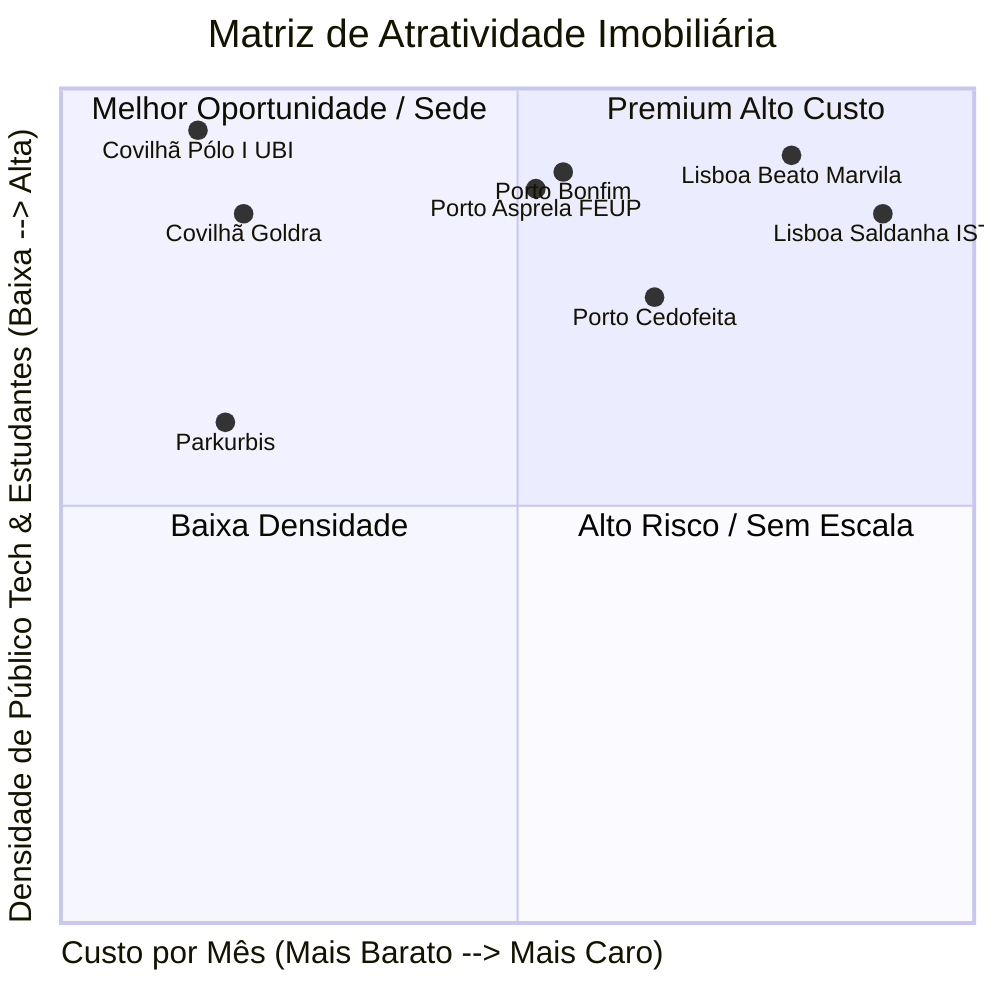

### Análise Comparativa de Imóveis

| Zona / Cidade | Tipologia | Área | Renda Estimada | Link Maps | Perfil de Público Alvo |
| :--- | :--- | :---: | :---: | :---: | :--- |
| **Pólo I UBI / Marquês d'Ávila (Covilhã)** | Loja em edifício histórico / cantaria | 140–175 m² | **€ 650 – € 950** | [Maps](https://maps.google.com/?q=Rua+Marqu%C3%AAs+d%27%C3%81vila+e+Bolama+Covilh%C3%A3) | Estudantes de Engenharia Informática UBI, docentes e investigadores. |
| **Goldra / Av. Universidade (Covilhã)** | Espaço amplo junto ao Elevador da Goldra | 150–190 m² | **€ 700 – € 1.050** | [Maps](https://maps.google.com/?q=Avenida+da+Universidade+Elevador+da+Goldra+Covilh%C3%A3) | Comunidade universitária geral, nómadas tech da Serra da Estrela. |
| **Parkurbis / Tortosendo (Covilhã)** | Módulo em Parque de Ciência e Tecnologia | 160–210 m² | **€ 600 – € 900** | [Maps](https://maps.google.com/?q=Parkurbis+Covilh%C3%A3) | Empresas de software, startups de IA e engenharia de telecomunicações. |
| **Bonfim / 24 de Agosto (Porto)** | Armazém térreo de esquina com montra | 150–180 m² | **€ 1.800 – € 2.400** | [Maps](https://maps.google.com/?q=Rua+do+Bonfim+Campo+24+de+Agosto+Porto) | Criativos, devs freelance, nómadas digitais internacionais. |
| **Asprela / Paranhos (Porto)** | Loja moderna próxima à FEUP/ISEP/UPTEC | 160–200 m² | **€ 1.700 – € 2.300** | [Maps](https://maps.google.com/?q=Rua+Dr.+Roberto+Frias+Paranhos+Porto) | +30.000 estudantes universitários de engenharia e ciência. |
| **Cedofeita / Breiner (Porto)** | Espaço clássico com pátio interior | 130–160 m² | **€ 2.300 – € 3.100** | [Maps](https://maps.google.com/?q=Rua+do+Breiner+Porto) | Turistas culturais, entusiastas de café de especialidade, designers. |
| **Hub Criativo Beato / Marvila (Lisboa)** | Galpão industrial com vigas de ferro | 160–220 m² | **€ 2.800 – € 3.800** | [Maps](https://maps.google.com/?q=Hub+Criativo+do+Beato+Rua+da+Manuten%C3%A7%C3%A3o+Lisboa) | Startups da Web Summit, multinacionais tech, nómadas dos EUA/Nórdicos. |
| **Saldanha / Arroios (Lisboa)** | Rés-do-chão comercial próximo ao IST | 130–170 m² | **€ 3.200 – € 4.400** | [Maps](https://maps.google.com/?q=Arroios+Saldanha+Lisboa) | Docentes e estudantes do Instituto Superior Técnico e consultores tech. |

---

## Tema 8: Orçamento Integral de Investimento (CapEx)

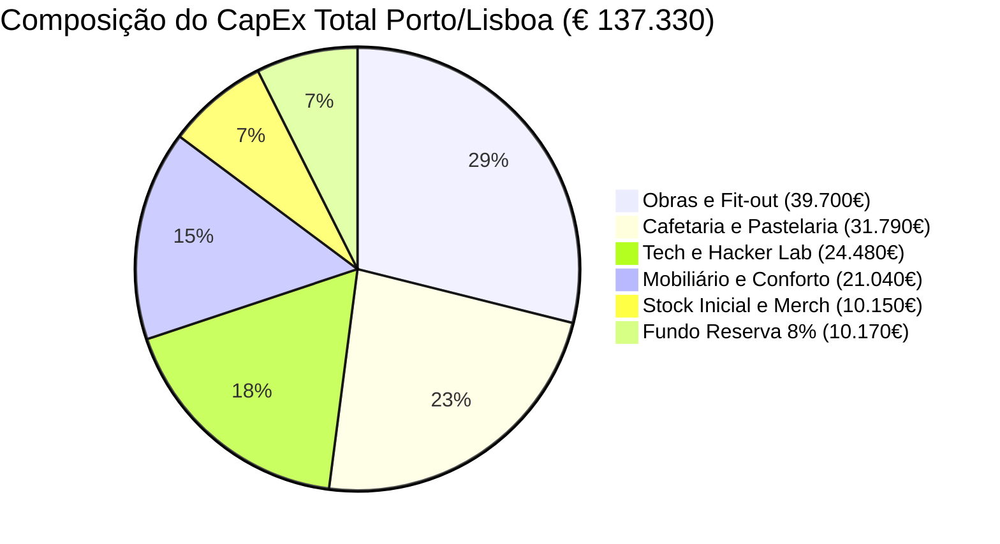

### Discriminação Integral dos 5 Lotes de Investimento

#### 1. Projetos, Licenciamento & Obras de Fit-Out (€ 39.700)
| Item | Descrição Técnica | Custo (€) |
| :--- | :--- | :---: |
| Arquitetura & Especialidades | Projetos de interiores, projeto acústico, elétrico e SCIE | € 5.500 |
| Licenciamento Camarário | Taxas municipais de restauração, vistorias sanitárias e certificação | € 2.200 |
| Demolições & Regularização | Remoção de divisórias e aplicação de piso vinílico/microcimento acústico | € 4.800 |
| Tratamento Acústico | Painéis ripados em madeira de nogueira com lã de rocha fonoabsorvente | € 6.800 |
| Eletricidade & DALI | Reforço trifásico (34.5kVA), calhas embutidas com USB-C PD, iluminação âmbar | € 8.500 |
| Climatização & AVAC | Sistema inverter multi-split conduta oculta + renovação de ar forçada | € 7.400 |
| Canalização & Sanitários | Remodelação de 2 instalações sanitárias (1 adaptada para mobilidade reduzida) | € 4.500 |

#### 2. Equipamento de Cafetaria de Especialidade & Pastelaria (€ 31.790)
| Equipamento | Marca / Modelo / Função | Custo (€) |
| :--- | :--- | :---: |
| Máquina Espresso Profissional | *La Marzocco Linea PB 2 Grupos* com PID duplo e controlo volumétrico | € 11.500 |
| Moinho Espresso Principal | *Mahlkönig E65S GbW* com pesagem automática integrada | € 2.450 |
| Moinho de Filtro / Lotes | *Mahlkönig EK43S* para moagem uniforme de V60, Chemex e Cold Brew | € 2.700 |
| Tratamento de Água | Sistema de osmose reversa e remineralização *BWT Bestmax Premium* | € 1.350 |
| Forno Convector com Vapor | *Unox Bakerlux Shop.Pro Touch* para Pão de Ló e massa folhada | € 3.800 |
| Batedeira Planetária | *KitchenAid Heavy Duty 6.9L* para massas fofas e claras batidas | € 890 |
| Vitrine Refrigerada | Vitrine vidro reto temperado com ventilação suave (+4°C a +8°C) | € 2.400 |
| Frigoríficos Gastronorm | 2x Balcões refrigerados inox de bancada com gavetas | € 2.200 |
| Congelador Profissional | Congelador vertical inox 700L para reserva de insumos | € 1.100 |
| Máquina de Lavar Louça | Ciclo industrial de 90 segundos com bomba automática de doseamento | € 1.950 |
| Acessórios Barista/Doces | Chaleiras Fellow Stagg, balanças Acaia Lunar, formas de barro tradicionais | € 1.450 |

#### 3. Mobiliário, Decoração & Conforto Lo-Fi (€ 21.040)
| Mobiliário / Decoração | Quantidade / Especificação | Custo (€) |
| :--- | :--- | :---: |
| Balcão Principal em Nogueira | Marcenaria por medida em nogueira e tampo em resina escura (5m) | € 5.200 |
| Sofás Couro Vintage | 2x Sofás 3 lugares estilo Chesterfield em pele genuína envelhecida | € 2.800 |
| Poltronas Individuais Veludo | 4x Poltronas ergonómicas de leitura em veludo castanho | € 1.400 |
| Mesas Baixas com Carregadores | 6x Mesas baixas em nogueira maciça com portas USB-C embutidas | € 1.500 |
| Bancadas Hacker (Long Desks) | 3x Bancadas compridas (4 postos cada) em nogueira e calha magnética | € 3.600 |
| Cadeiras Ergonómicas | 12x Cadeiras com apoio lombar dinâmico (Sihoo Doro S300 / Steelcase) | € 3.840 |
| Estantes Industriais | 2x Estantes modulares em aço preto fosco e prateleiras de madeira | € 850 |
| Iluminação Âmbar Vintage | 14 pendentes de vidro âmbar com lâmpadas Edison e 8 de mesa | € 1.250 |
| Plantas & Jardineiras | Pothos, Monstera e Ficus com autorrega para purificação interior | € 600 |

#### 4. Infraestrutura Tecnológica & Hacker Lab (€ 24.480)
| Componente Tech | Especificação | Custo (€) |
| :--- | :--- | :---: |
| Rack & Gateway de Rede | *Ubiquiti UniFi Dream Machine Pro SE* (10G SFP+) + Switch 24p PoE | € 1.650 |
| Pontos de Acesso Wi-Fi 7 | 3x *UniFi U7 Pro* para 300+ conexões simultâneas de baixa latência | € 690 |
| Cablagem Cat6A 10G | 24 pontos RJ-45 certificados com tomadas blindadas | € 1.400 |
| Monitores 4K Dell | 8x *Dell UltraSharp 32" 4K (U3223QE)* com Hub USB-C 90W PD | € 6.400 |
| Braços Articulados | 8x Suportes articulados a gás em alumínio preto mate | € 640 |
| Teclados & Ratos | 6x Keychron Q1 Pro (switches lubrificados) + 6x Logitech MX Master 3S | € 1.550 |
| Cabines Acústicas Privadas | 2x Cabines pré-fabricadas insonorizadas com vidro laminado duplo | € 7.500 |
| Bancada Maker | 2x Ferros Pinecil, osciloscópio Rigol, kits ESP32/Raspberry Pi 5 | € 1.350 |
| Sistema de Som Analógico | Amplificador a válvulas, 4x Wharfedale Diamond e gira-discos Pro-Ject | € 1.850 |
| Sistema POS de Balcão | 2x iPads com suporte em alumínio, gaveta de dinheiro e impressora térmica | € 1.450 |

#### 5. Stock Inicial, Merchandising & Sinalética (€ 10.150)
| Rubrica | Quantidade / Especificação | Custo (€) |
| :--- | :--- | :---: |
| Café & Ingredientes Frescos | 80 kg grão arábica especialidade, ovos biológicos, manteiga DOP, farinhas | € 2.200 |
| Produção Inicial de Merch | 40 hoodies, 60 t-shirts, 50 canecas artesanais, 30 desk mats, 300 stickers | € 3.900 |
| Embalagens Kraft Takeaway | 2.000 caixas de Pão de Ló/Mil-Folhas carimbadas, copos bio, guardanapos | € 1.650 |
| Sinalética & Néon Âmbar | Placas gravadas a laser em alumínio e letreiro exterior em néon âmbar | € 2.400 |

### Comparativo de CapEx por Cenário Geográfico

| Parâmetro | Cenário A: Covilhã (Hub Inicial UBI) | Cenário B: Porto / Lisboa (Expansão) |
| :--- | :---: | :---: |
| **Obras e Acústica** | € 18.500 | € 39.700 |
| **Cafetaria & Pastelaria** | € 16.200 | € 31.790 |
| **Tecnologia & Hacker Lab** | € 11.400 | € 24.480 |
| **Mobiliário & Conforto** | € 8.800 | € 21.040 |
| **Stock Inicial & Merch** | € 3.500 | € 10.150 |
| **Subtotal CapEx Direto** | **€ 58.400** | **€ 127.160** |
| **Fundo de Contingência (8%)** | € 4.000 | € 10.170 |
| **TOTAL GERAL DE ARRANQUE** | **€ 62.400** | **€ 137.330** |

---

## Tema 9: Custos Operacionais (OpEx) & Modelo Financeiro de Break-Even

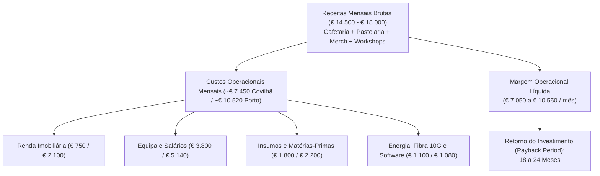

### Comparativo Mensal de Custos Fixos (OpEx)

| Rubrica de Custo | Cenário Covilhã (UBI) | Cenário Porto (Bonfim) |
| :--- | :---: | :---: |
| **Renda Comercial** | € 750 / mês | € 2.100 / mês |
| **Chefe Barista de Especialidade** | € 1.500 / mês | € 1.800 / mês |
| **Pasteleiro/a Artesanal (Pão de Ló & Folhados)**| € 1.500 / mês | € 1.740 / mês |
| **Baristas Part-time (Noites/Fim de semana)** | € 800 / mês | € 1.600 / mês |
| **Eletricidade Trifásica & Água** | € 600 / mês | € 750 / mês |
| **Fibra Ótica Dedicada Simétrica 10G** | € 180 / mês | € 180 / mês |
| **Reposição de Insumos (Café, ovos, manteiga)** | € 1.800 / mês | € 2.200 / mês |
| **Software POS, Licenças & Contabilidade** | € 320 / mês | € 350 / mês |
| **Total OpEx Mensal:** | **€ 7.450 / mês** | **€ 10.720 / mês** |

### Projeção de Faturação e Ponto de Equilíbrio (Break-Even)
* **Ticket Médio:** € 2.60 a € 3.20.
* **Volume Diário de Transações:** 140 a 200 consumos/dia.
* **Linhas de Receita Adicionais:** 
  - Merchandising (hoodies, canecas, desk mats): € 800 – € 1.200 / mês.
  - Workshops Maker & Red Team aos fins de semana: € 1.500 – € 2.200 / mês.
* **Break-Even Point:** Atingido com **~85 a 95 consumos/dia** (Covilhã) ou **~145 consumos/dia** (Porto).

---

## Tema 10: Academia Hacker, Formações Especializadas & Especificações do Bunker

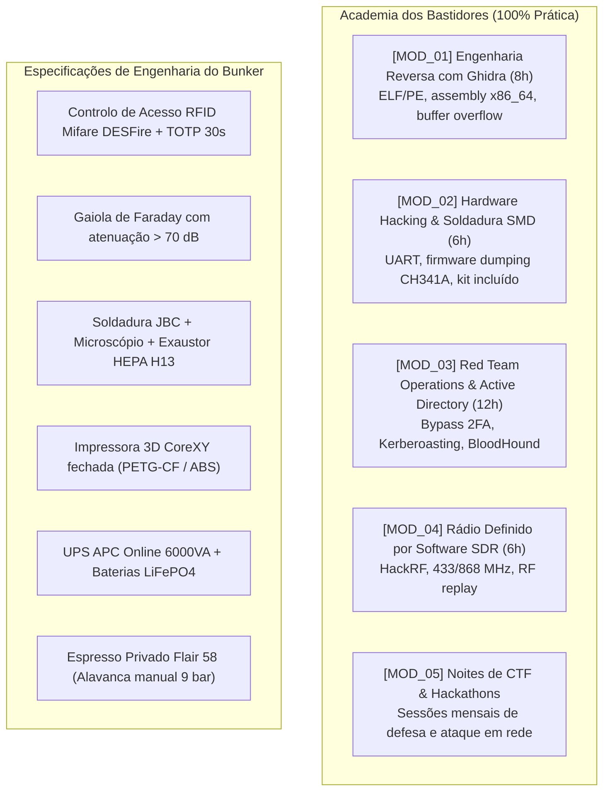

### Módulos Oficiais da Academia Prática dos Fundadores

| Código | Módulo / Formação | Carga Horária | Conteúdo Programático & Requisitos | Lotação Máxima |
| :---: | :--- | :---: | :--- | :---: |
| **MOD_01** | **Engenharia Reversa com Ghidra: Desmontar Binários do Zero** | 8h (Fim de semana) | Análise de ficheiros ELF/PE em C/C++, assembly x86_64 e ARM, identificação de buffer overflows e reconstrução de fluxo sem código fonte. | 8 participantes |
| **MOD_02** | **Hardware Hacking Prático: Soldadura SMD, UART e Firmware Dump** | 6h | Ligação física via pinos UART a routers/IoT, shell root, dumping de chips SPI flash com programador CH341A e análise SquashFS. Kit de hardware incluído para levar. | 6 participantes |
| **MOD_03** | **Red Team Operations: Evasão de EDR e Active Directory** | 12h (2 Dias) | Simulação real de intrusão corporativa: OSINT avançado, bypass de MFA, exploração de Active Directory (Kerberoasting, BloodHound) e movimentação lateral. | 4 participantes / equipa |
| **MOD_04** | **Rádio Definido por Software (SDR) & Análise de Sinais RF** | 6h | RTL-SDR e HackRF One na banda ISM (433/868 MHz), captura e descodificação de telemática e comandos sem fios. Requer portátil Linux. | 8 participantes |
| **MOD_05** | **Noites de CTF, Hackathons & Tertúlias de Criptografia** | 4h (Noturno) | Encontros mensais de resolução colaborativa de máquinas "Capture The Flag", análise de novos exploits e partilha de conhecimento livre. | 16 participantes |

### Especificações de Engenharia do Bunker (Subsolo Técnico)

| Subsistema | Equipamento / Especificação | Função Operacional no Espaço |
| :--- | :--- | :--- |
| **Controlo de Acesso** | Leitor RFID 13.56 MHz (Mifare DESFire EV3) + Teclado mecânico TOTP rotativo a cada 30s. | Garante entrada restrita a fundadores e alunos credenciados. |
| **Gaiola de Faraday** | Caixa blindada RF com atenuação de blindagem superior a 70 dB de 100 kHz a 6 GHz. | Permite testes e emissão controlada de rádio sem vazar para a via pública. |
| **Bancada de Soldadura** | Estações JBC de alta precisão, microscópio estéreo contínuo e exaustor HEPA H13. | Soldadura e retrabalho seguro de micro-BGA, QFN e pistas microscópicas. |
| **Prototipagem 3D** | Impressora 3D CoreXY fechada com câmara aquecida e bicos de aço endurecido (Carbon Fiber PETG/ABS). | Fabrico rápido de carcaças, gabaritos de teste e ferramentas personalizadas. |
| **Energia Ininterrupta** | UPS APC Smart-UPS Online trifásica de 6000 VA ligada a banco de baterias LiFePO4. | Mantém servidores, impressoras 3D e estações de soldar operacionais em cortes de energia. |
| **Espresso do Bunker** | Máquina manual de alavanca Flair 58 com manómetro e moinho cónico de 71mm. | Extração personalizada com pré-infusão longa de 15 segundos para as madrugadas de CTF. |

---

## Tema 11: Infraestrutura de Telecomunicações, Cibersegurança & Regras de Convivência

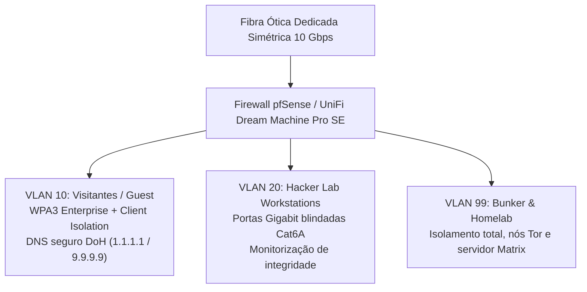

### Matriz de Telecomunicações e Segurança de Rede

| Parâmetro | Configuração Técnica | Propósito Operacional |
| :--- | :--- | :--- |
| **Acesso WAN** | Fibra Ótica Dedicada Simétrica 10 Gbps redundante com failover 5G. | Latência inferior a 2ms, ideal para compilação remota e stream de áudio lo-fi. |
| **SSID Wi-Fi Principal** | `PLAN_B_GUEST_5GHZ` com Wi-Fi 6E/7 (UniFi U7 Pro). | Cobertura integral com suporte a mais de 300 dispositivos em simultâneo. |
| **Isolamento de Clientes** | Client Isolation ativo em nível de camada 2 (L2). | Impede que qualquer computador na rede pública consiga espiar tráfego de terceiros. |
| **Criptografia & DNS** | WPA3 Enterprise + DNS over HTTPS (DoH) com Cloudflare/Quad9. | Proteção contra interceção de tráfego, man-in-the-middle e censura de DNS. |
| **Nó Matrix & Comunidade** | Servidor descentralizado Matrix local (`#planb:matrix.org`) e canal Telegram. | Comunicação segura e encriptada ponta a ponta sem dependência de plataformas proprietárias. |
| **PGP Key Fingerprint** | `7F3B 98A2 4C10 D89E 02FA` | Assinatura oficial das comunicações confidenciais dos fundadores. |

### Regras de Convivência e Foco
1. **Chamadas de Voz e Vídeo:** Restritas obrigatoriamente às **2 cabines acústicas privadas**. Não são permitidas chamadas em altifalante no piso do cybercafé.
2. **Uso de Auscultadores:** Obrigatório em todas as estações hacker e sofás do lounge. O áudio do espaço é preenchido exclusivamente pela estação lo-fi em vinil.
3. **Hardware Hacking Responsável:** Testes de RF emissores com SDR só podem ocorrer dentro da Gaiola de Faraday blindada.
4. **Política de Mesas Limpas:** Copos e loiça devem ser devolvidos ao balcão após o consumo.

---

## Tema 12: Terminal CLI Interativo, Comandos & Telemetria em Tempo Real

O portal web integra um emulador de terminal CLI em bash (`guest@planb-cybercafe:~`) que responde a comandos funcionais e simula a telemetria do sistema:

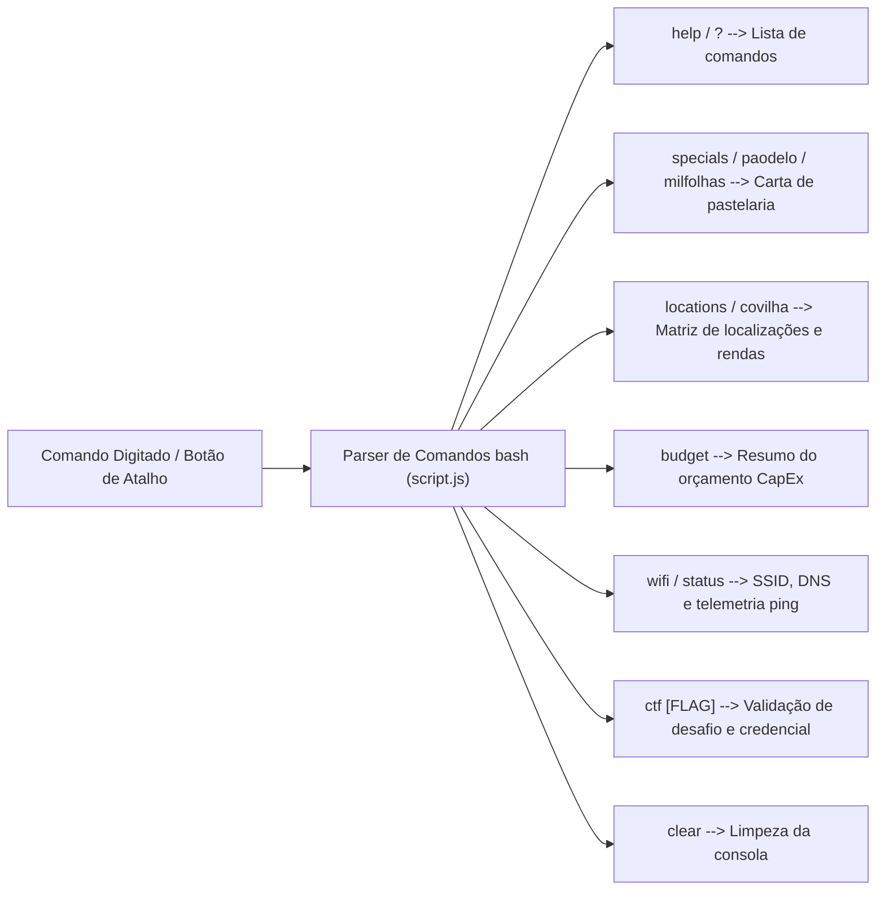

### Dicionário de Comandos Disponíveis no Terminal

| Comando | Descrição da Resposta no Ecrã |
| :--- | :--- |
| `help` / `?` | Imprime a lista completa de comandos disponíveis e instruções de navegação. |
| `covilha` | Apresenta detalhes do Hub Principal da UBI na Covilhã (Rua Marquês d'Ávila, rendas e ligação à universidade). |
| `specials` | Exibe as duas especialidades gastronómicas de assinatura (Pão de Ló e Mil-Folhas). |
| `paodelo` | Ficha técnica e história do Pão de Ló tradicional português sem qualquer recheio (€ 1.80). |
| `milfolhas` | Ficha do Mil-Folhas artesanal de café arábica e massa folhada estaladiça (€ 2.20). |
| `locations` | Tabela formatada em texto com os 8 espaços mapeados (Covilhã, Porto e Lisboa). |
| `budget` | Sumário financeiro consolidado dos 5 lotes de CapEx (€ 137.330 Porto / € 58.400 Covilhã). |
| `merch` | Lista dos produtos oficiais de vestuário, canecas artesanais e periféricos. |
| `wifi` | Exibe as credenciais de rede, parâmetros de encriptação e o token encriptado do captive portal. |
| `ctf <FLAG>` | Submete a flag encontrada no puzzle criptográfico para verificação instantânea. |
| `clear` | Limpa o ecrã do terminal e reinicia o prompt limpo. |

---

## Tema 13: Desafio Criptográfico (CTF Captive Portal & Credencial Hacker)

Para manter a fidelidade à cultura hacker e filtrar o acesso a descontos exclusivos nos workshops dos bastidores, o portal web implementa um mini-CTF client-side estático (compatível com GitHub Pages):

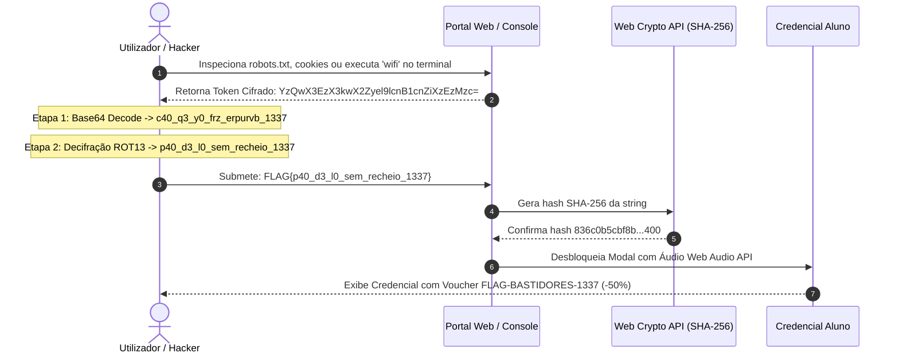

---

## Tema 14: Catálogo Visual & Galeria Fotográfica do Espaço

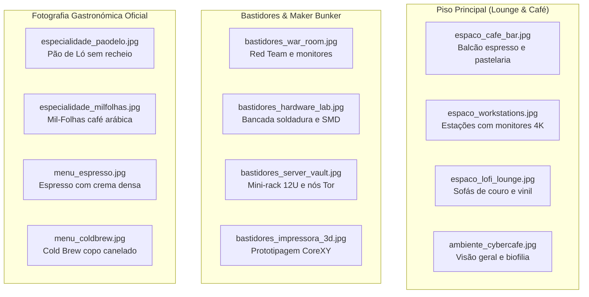

| Ficheiro de Ativo | Âmbito | Descrição Visual |
| :--- | :--- | :--- |
| `assets/espaco_cafe_bar.jpg` | Piso 1 | Balcão em nogueira e latão com máquina La Marzocco e iluminação âmbar 2200K. |
| `assets/espaco_workstations.jpg` | Piso 1 | Estações hacker com monitores 4K foscos, teclados Keychron Q e iluminação focada. |
| `assets/espaco_lofi_lounge.jpg` | Piso 1 | Canto de leitura com sofás de couro conhaque, gira-discos e fones abertos. |
| `assets/ambiente_cybercafe.jpg` | Piso 1 | Panorâmica da atmosfera lo-fi, paredes em tons escuros e isolamento acústico. |
| `assets/bastidores_war_room.jpg` | Bastidores | Bunker com betão aparente, calhas suspensas, ThinkPads e dashboards de CTF. |
| `assets/bastidores_hardware_lab.jpg` | Bastidores | Bancada de eletrónica com osciloscópio Rigol, microscópio SMD e ferros de precisão. |
| `assets/bastidores_server_vault.jpg` | Bastidores | Mini-rack 12U com switch 24p, cluster de nós descentralizados e graffiti stencil. |
| `assets/bastidores_impressora_3d.jpg` | Bastidores | Estação de impressão 3D CoreXY fechada com bobinas de filamento técnico. |
| `assets/especialidade_paodelo.jpg` | Gastronomia | Pão de Ló tradicional português (massa dourada, fofa e arejada, sem recheio). |
| `assets/especialidade_milfolhas.jpg` | Gastronomia | Mil-Folhas artesanal com camadas caramelizadas crocantes e creme de café Bourbon. |
| `assets/merchandising_planb.jpg` | Merch | Linha de 10 artigos oficiais (hoodies, t-shirts, canecas cerâmicas e desk mats). |
| `Loading.mp4` | Vídeo | Vídeo cinematográfico hacker de transição para os bastidores. |
